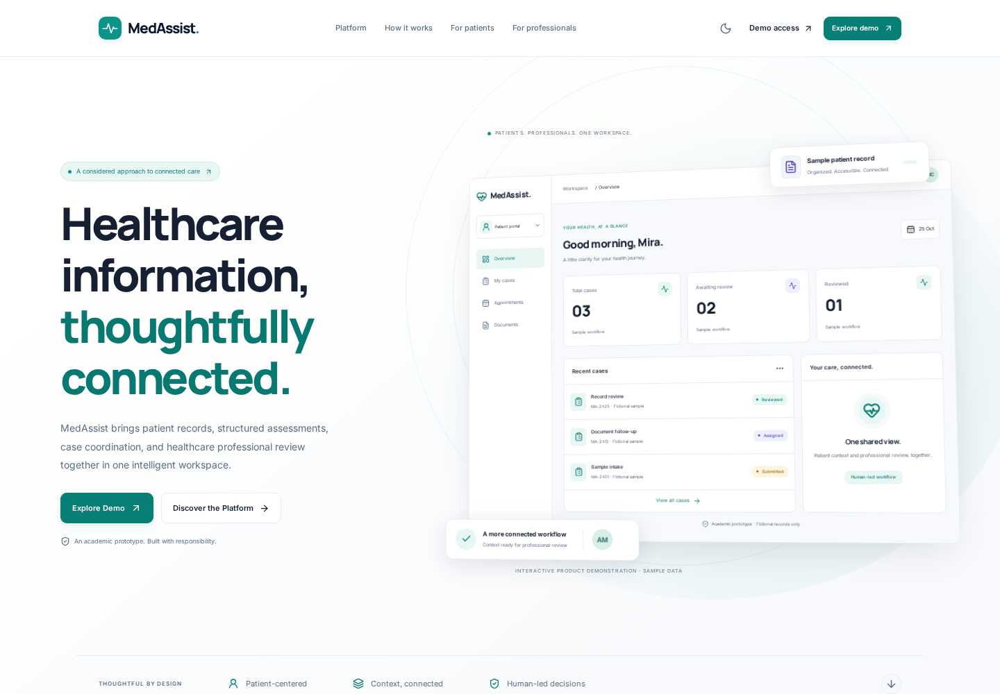

# MedAssist

**An AI-Assisted Healthcare Triage and Patient Management Platform**

MedAssist is a B.Tech CSE student project by Saloni Pandey. This repository
contains a responsive React/TypeScript product frontend, a small FastAPI system API,
and the original academic planning documents. All product workflows use fictional
demonstration data; this is not a clinically deployed healthcare service.

## Current status

- Implemented: API welcome response, GET/HEAD liveness checks, typed response
  schemas, request IDs, optional frontend origins, generated API docs, HTTP
  contract tests, and automated backend checks.
- Frontend: public product website and distinct patient, doctor and administrator
  workspaces, with light/dark themes, case/review workflows, fictional appointments,
  safe document previews, searchable tables and derived sample analytics. Changes
  stay in memory and reset on reload. No real clinical input or scoring is available.
- Preserved: original HTML/CSS/JavaScript demo at `frontend/public/legacy/`,
  with all original nonclinical safeguards retained.
- Planned: persistent patient management, authentication, database storage, and
  triage assistance. These features are not implemented yet.
- The prototype does not provide medical advice or clinical decision support.

## Explore the product frontend



Requires Node.js **22.12 or newer**. From the repository root:

```bash
cd frontend
npm ci
npm run dev
```

Open **http://127.0.0.1:5173** and choose **Explore Demo**. No backend or account is
needed for the fictional product demonstration. Do not enter real health information.

- **Patient:** profile preferences, six-step fixed sample assessment, case tracking,
  fictional appointment requests, document previews and notifications.
- **Doctor:** assigned-case queue, split-panel independent review, patient context
  and fictional appointment schedule.
- **Administrator:** interactive sample analytics, user management, chronological
  sample events and optional system-liveness check.

The header switches fictional perspectives. Reloading or Settings → Reset demo data
restores the original dataset. Role switching is not authentication. AI classification,
real patient storage and real file uploads remain unavailable.

For all routes, architecture, capabilities, optional API wiring and backend next steps,
read the [frontend guide](docs/FRONTEND_GUIDE.md). The
[audit](docs/FRONTEND_AUDIT.md) records the original implementation boundary.

### Build and verify the frontend

Run from `frontend`:

```bash
npm run typecheck
npm run build
npm test
npx playwright install chromium
npm run test:e2e
npm run format:check
```

Use `npm run preview` to inspect the production build at **http://127.0.0.1:4173**.
The browser suite runs against the compiled build. On a minimal Linux host, install
browser system libraries with `npx playwright install --with-deps chromium`.

The original static demo is still available at `/legacy/index.html` through Vite,
or by opening `frontend/public/legacy/index.html` directly. Its original safeguards
can be verified independently from the repository root:

```bash
node --test frontend/tests/nonclinical-demo.test.cjs
```

See [recorded verification results](docs/VERIFICATION.md) and
[additional screenshots](docs/screenshots/README.md).

## Run locally

Prerequisite: Python 3.10 or newer with `pip` and `venv` available. Clone the
repository first:

```bash
git clone https://github.com/salonipandey-dev/MedAssist.git
cd MedAssist
```

### Windows PowerShell

Run these commands from the repository folder. Calling the virtual environment's
Python directly also works when PowerShell blocks activation scripts.

```powershell
cd backend
py -m venv .venv
.\.venv\Scripts\python.exe -m pip install -r requirements.txt
.\.venv\Scripts\python.exe -m uvicorn app.main:app --reload
```

### macOS or Linux

```bash
cd backend
python3 -m venv .venv
source .venv/bin/activate
python -m pip install -r requirements.txt
python -m uvicorn app.main:app --reload
```

Keep the server terminal open. Visit <http://127.0.0.1:8000/docs> to try the API.
Use `Ctrl+C` to stop the development server. `--reload` is for local development.

The [sample API requests](backend/requests.http) include welcome, GET/HEAD health,
OpenAPI, and error examples with expected status codes. Open the file in an HTTP
client that supports `.http` files, such as VS Code with the REST Client
extension, and run each request while the server is running. Edit `@baseUrl` if
you use a different port. These examples do not require a database or login.

## Available endpoints

| Method | Path | Purpose |
| --- | --- | --- |
| GET | `/` | Return the existing backend welcome message |
| GET | `/health` | Check that the API is responding |
| HEAD | `/health` | Check liveness headers without downloading a response body |
| GET | `/docs` | Open interactive Swagger documentation |
| GET | `/redoc` | Open ReDoc documentation |
| GET | `/openapi.json` | Retrieve the OpenAPI schema |

Example response from `/health`:

```json
{
  "status": "ok",
  "service": "medassist-api",
  "version": "0.1.0"
}
```

This is a liveness check. It does not check a database or any external service.
Successful health responses send `Cache-Control: no-store` so browsers and
intermediaries do not store a stale liveness result. Conditional cache headers
also receive a fresh `200 OK` liveness response instead of `304 Not Modified`.
Monitoring tools can use `HEAD /health` for the same status and headers without
a response body. For example, run `curl -I http://127.0.0.1:8000/health` (use
`curl.exe -I` in Windows PowerShell). HEAD requests also receive an `X-Request-ID`.
The welcome and health responses have named schemas in `/docs` and
`/openapi.json`, including their required fields.

## Trace a request

Successful responses and handled client errors (such as 404 and 405) include an
`X-Request-ID` response header. The API generates a new UUID for each HTTP request;
caller-supplied IDs are replaced. Include this ID when reporting an API problem.
Routes can access the same value through `request.state.request_id`. Request
tracing does not record request bodies or patient information.

Unexpected route failures before a response starts return a generic `500 Internal
Server Error` with the same request ID. Exception details stay out of the response;
the exception still propagates to the server for logging and debugging. Responses
that have already started cannot be replaced by this error handler.

```bash
curl -i http://127.0.0.1:8000/health
```

An allowed frontend can read the header with
`response.headers.get("X-Request-ID")`; it is exposed by the CORS configuration.

## Connect a local frontend

Cross-origin browser access is disabled by default. To let a frontend read the
API, set `MEDASSIST_CORS_ORIGINS` in the server terminal before starting Uvicorn.
Use the frontend's exact origin: protocol, host, and port, without a trailing
slash or path. Multiple origins are separated by commas.

Windows PowerShell, from `backend`:

```powershell
$env:MEDASSIST_CORS_ORIGINS = "http://localhost:5173,http://127.0.0.1:5173"
.\.venv\Scripts\python.exe -m uvicorn app.main:app --reload
```

macOS or Linux, from `backend` with the virtual environment activated:

```bash
MEDASSIST_CORS_ORIGINS="http://localhost:5173,http://127.0.0.1:5173" python -m uvicorn app.main:app --reload
```

Only the configured origins and GET/HEAD requests are permitted by the browser CORS
policy. Credentialed browser requests are disabled. Invalid origins (including
wildcards and URLs with paths) stop startup with a configuration error.
Settings are read when the app is created, so restart the server after changes.
`.env` files are not loaded automatically.

To disable this setting in PowerShell, run
`Remove-Item Env:MEDASSIST_CORS_ORIGINS` and restart the server. In a Unix shell,
use `unset MEDASSIST_CORS_ORIGINS` if you previously exported it. CORS does not
replace the authentication and access controls planned for patient workflows.

## Run the tests

In another terminal, enter the `backend` folder. The development requirements
include the runtime requirements and HTTPX2 for FastAPI's test client. The tests
use Python's built-in `unittest` runner.

Windows PowerShell:

```powershell
.\.venv\Scripts\python.exe -m pip install -r requirements-dev.txt
.\.venv\Scripts\python.exe -m unittest discover -s tests -v
```

macOS or Linux, with the virtual environment activated:

```bash
python -m pip install -r requirements-dev.txt
python -m unittest discover -s tests -v
```

The tests cover the existing welcome response, GET/HEAD health responses and their
cache policy, rejection of POST requests to the health route, required OpenAPI
fields, CORS defaults,
allowed and unlisted origins, preflight requests, invalid settings, request ID
generation, unexpected server failures, and browser access to response IDs.

The [Backend tests workflow](.github/workflows/backend-tests.yml) runs the suite
and checks installed dependency compatibility on Ubuntu and Windows with Python
3.10 and 3.14. It runs for backend or workflow changes pushed to `main`, for
matching pull requests, and on manual dispatch from the Actions tab.

## Repository layout

- `frontend/src/`: typed React product frontend, role-specific features and
  isolated synthetic-data services.
- `frontend/public/legacy/`: original static demo, preserved with its safeguards.
- `frontend/tests/`: nonclinical boundary checks and compiled-browser workflows.
- `docs/FRONTEND_GUIDE.md`: frontend setup, architecture, feature matrix and integration plan.
- `backend/app/main.py`: application factory, system routes, and Uvicorn app.
- `backend/app/config.py`: environment configuration for frontend origins.
- `backend/app/middleware.py`: server-generated HTTP request IDs.
- `backend/app/schemas.py`: public system response models.
- `backend/requirements.txt`: pinned runtime dependencies.
- `backend/requirements-dev.txt`: runtime dependencies plus test client support.
- `backend/requests.http`: runnable local API examples and expected responses.
- `backend/tests/`: HTTP contract tests.
- `docs/`: project synopsis, presentation, and evaluation report.
- `.github/workflows/backend-tests.yml`: automated backend checks.

See [CONTRIBUTING.md](CONTRIBUTING.md) for the development workflow.

Virtual environments, Python caches, and local environment files are ignored by
Git. Keep credentials and real patient information out of the repository.

## Troubleshooting

- **`uvicorn` is not recognized:** use `python -m uvicorn` from the active
  environment, or the full virtual environment Python command shown above.
- **Cannot import `app.main`:** run the server from `backend`, where the `app`
  folder lives.
- **PowerShell refuses `Activate.ps1`:** use the Windows commands above; changing
  your execution policy is unnecessary.
- **Port 8000 is in use:** add `--port 8001` to the server command and open
  <http://127.0.0.1:8001/docs> instead.

## Next development steps

1. Define the patient data model and database migrations.
2. Add authentication and access controls before storing patient information.
3. Build and validate the patient management workflow.
4. Explore triage assistance after the core workflow is working.
